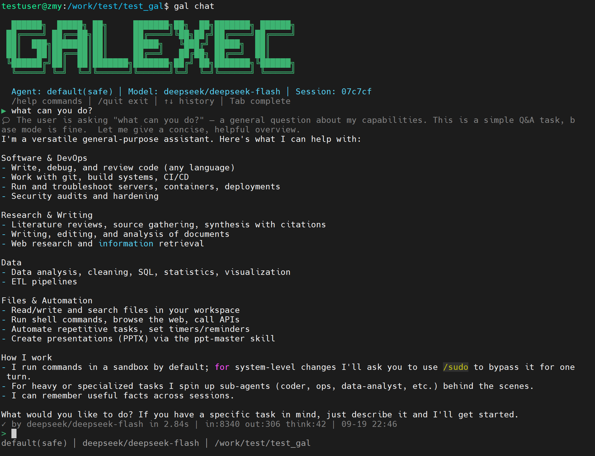
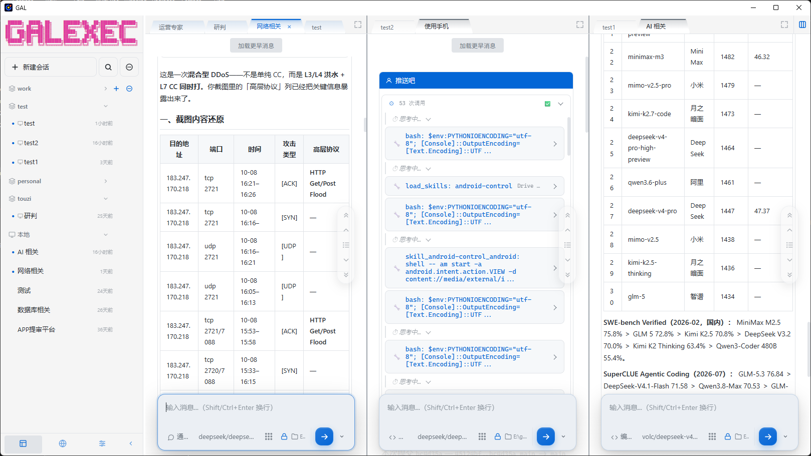

<p align="center">
  <a href="https://github.com/gal-agent/gal-release/releases/latest"></a>
  
  
  
  <a href="https://github.com/gal-agent/gal-release/stargazers"></a>
  <a href="https://github.com/gal-agent/gal-release/releases"></a>
</p>

# GAL

[中文文档](README_CN.md)

**GAL — General Agent Loop & Executor.** An LLM agent you can let loose. One binary serves the terminal, a desktop app and your IM channels on Linux, macOS and Windows. Zero install, and a kernel-enforced sandbox that stays on.



```bash
# Linux / macOS
./gal init && ./gal chat

# Windows GUI — double-click galw.exe, done.
```

<p align="center"></p>

> ★ **If GAL saves you time, please [star this repo](https://github.com/gal-agent/gal-release/stargazers).** Stars are how the next person finds it.

---

## One binary, three front ends

| Front end | Binary | Start it |
|-----------|--------|----------|
| Terminal / SSH | `gal` | copy the file, run it |
| Desktop app | `galw` | copy the file, double-click |
| IM / HTTP server | `gal serve` | copy the file, fill in tokens, run it |

CLI, GUI and IM run the same engine, on the same session files in `~/.gal/sessions/`, under the same sandbox policy — start at your desk, continue from your phone.

## What sets it apart

### Safe on a real machine, not a toy

Kernel-level sandboxing, the same security model on every OS:

- **Linux** — a private mount namespace (`CLONE_NEWNS`) plus OverlayFS, created by the binary itself through `mount(2)`. No `bwrap`, no `unshare`, no helper package on the host. `$HOME` is overlay-mounted: `~/.aws/config` still reads normally, while writes land in tmpfs and never reach the disk. `PR_SET_NO_NEW_PRIVS` blocks setuid escalation.
- **macOS** — a Seatbelt profile (`sandbox-exec`) generated from the same policy.
- **Windows** — a restricted token (`CreateRestrictedToken` with `WRITE_RESTRICTED`): writes are confined to the project directory, the session temp and the toolchain caches, while reads stay unrestricted so every tool reads and stats files exactly as it does outside GAL.

The agent keeps full productivity inside your project and cannot corrupt the machine or exfiltrate secrets. Need to install a package or restart a service? `/sudo <msg>` grants exactly one turn of unrestricted access and snaps back automatically.

### Context that survives long sessions

The agent decides what to summarise and what to keep, instead of a fixed truncation policy. Tens of thousands of agent rounds in one session, the current round always protected, images unloaded once they have been used.

### Self-extending

- **Skills** — drop a `SKILL.md` and its scripts into a folder, the agent picks the skill up and the scripts become tools.
- **MCP** — connect any MCP server; its tools and resources appear automatically, loaded on demand.

### Any model you like

Any OpenAI-compatible or Anthropic endpoint works — the built-in picker covers 50 vendors, and switching model or provider never needs a reinstall.

---

## Downloads

Every [Release](https://github.com/gal-agent/gal-release/releases) carries platform-specific archives. The binary inside has a clean name (`gal` / `galw`); the platform is encoded in the archive name only.

| Platform | CLI (`gal`) | GUI (`galw`) |
|----------|-------------|--------------|
| Linux amd64 | `gal-linux-amd64.tar.gz` | `galw-linux-amd64.tar.gz` |
| macOS amd64 (Intel) | `gal-darwin-amd64.tar.gz` | `galw-darwin-amd64.zip` |
| macOS arm64 (Apple Silicon) | `gal-darwin-arm64.tar.gz` | `galw-darwin-arm64.zip` |
| Windows amd64 | `gal-windows-amd64.zip` | `galw-windows-amd64.zip` |

### What is inside each archive

| Archive | Contents |
|---------|----------|
| `gal-linux-amd64.tar.gz` | `gal` |
| `gal-darwin-*.tar.gz` | `gal`, `install.sh`, `README.txt` |
| `gal-windows-amd64.zip` | `gal.exe` |
| `galw-linux-amd64.tar.gz` | `galw` |
| `galw-darwin-*.zip` | `galw-darwin-<arch>/GAL.app`, `install.command`, `install.sh`, `README.txt` |
| `galw-windows-amd64.zip` | `galw.exe` |

### Quick start

```bash
# Linux — nothing to install
tar xzf gal-linux-amd64.tar.gz
./gal init && ./gal chat

# macOS CLI — the tarball ships an installer that clears the quarantine flag
tar xzf gal-darwin-arm64.tar.gz
bash install.sh

# macOS GUI — the zip is not a bare .app, its installer handles the same flag
unzip galw-darwin-arm64.zip
cd galw-darwin-arm64 && bash install.sh

# Windows
#   CLI: extract gal-windows-amd64.zip, run gal.exe
#   GUI: extract galw-windows-amd64.zip, double-click galw.exe
```

### First launch on macOS

GAL is not notarised by Apple, so macOS tags every download with a quarantine flag. Depending on the macOS version you see one of two dialogs:

- **"cannot be opened because the developer cannot be verified"** — right-click the file, choose **Open**, then **Open** again. That approval is remembered.
- **"is damaged and can't be opened" / "已损坏"** — right-click does not help; this is the same quarantine flag, not a corrupt file. Clear it from a terminal: `xattr -cr gal` for the CLI, `xattr -cr GAL.app` for the app, or just run the bundled `install.sh` / `install.command`.

If Finder blocks `install.command` itself, run it from a terminal (`bash install.sh`) — the Finder block does not apply there.

### Requirements

| Platform | Needed |
|----------|--------|
| Linux (CLI) | nothing — statically linked, works in any container or over SSH |
| Linux (GUI) | WebKitGTK 4.1 (`libwebkit2gtk-4.1-0`) and GTK 3 for the native window; without them the same GUI opens in your browser |
| macOS | macOS 12 or newer; the native window needs macOS 14 or newer, on 12–13 the same GUI opens in your browser |
| Windows | Windows 10 1803+ for the GUI (WebView2 ships with it); the CLI needs nothing |

### Verify checksums

Each release includes a `checksums.txt`:

```bash
sha256sum -c checksums.txt --ignore-missing
```

---

## Feedback

- 🐛 **Bug report** — [open an issue](https://github.com/gal-agent/gal-release/issues/new?labels=bug)
- ✨ **Feature request** — [open an issue](https://github.com/gal-agent/gal-release/issues/new?labels=enhancement)
- 💬 **Website form** — [agent-home.ai/feedback.html](https://agent-home.ai/feedback.html)

## Community

Scan the QR code to join the user feedback group (Feishu):

<p align="center"></p>

## Links

- [Official website](https://agent-home.ai) — docs, downloads, feedback
- [Latest release](https://github.com/gal-agent/gal-release/releases/latest) — newest build
- [All releases](https://github.com/gal-agent/gal-release/releases) — full version history

## License

GAL is released under the Apache License 2.0 — the binaries in this repository are distributed under its terms. Third-party components and their notices are listed in the `NOTICE` file of the source distribution.

