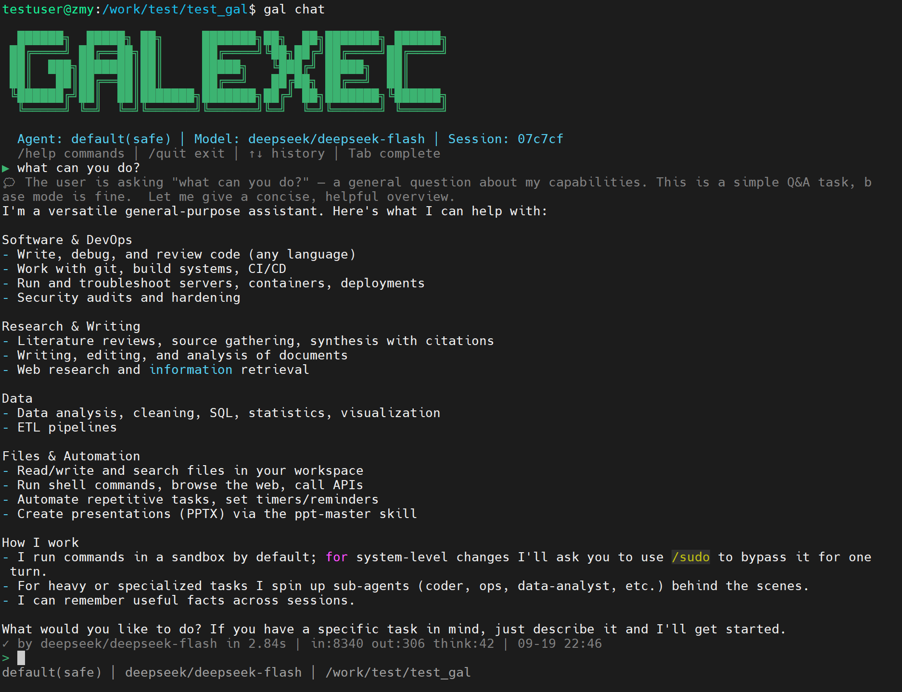
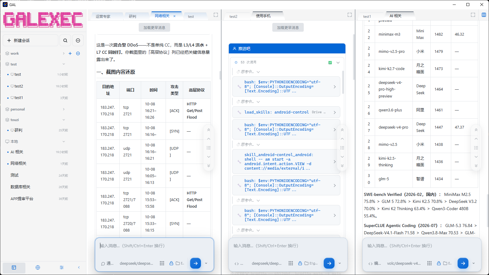

<p align="center">
  <a href="https://github.com/gal-agent/gal-release/releases/latest"></a>
  
  
  
  <a href="https://github.com/gal-agent/gal-release/stargazers"></a>
  <a href="https://github.com/gal-agent/gal-release/releases"></a>
</p>

# GAL 发版仓库

[English](README.md)

**GAL —— General Agent Loop & Executor。可以放手干活的 LLM 智能体。** 一个二进制，同时提供终端、桌面端和 IM 三种形态，覆盖 Linux、macOS、Windows。零安装，内核级沙箱默认开启。



```bash
# Linux / macOS
./gal init && ./gal chat

# Windows GUI —— 双击 galw.exe 即可
```

<p align="center"></p>

> ★ **如果 GAL 帮你省下了时间，欢迎[点个 Star](https://github.com/gal-agent/gal-release/stargazers)。** 更多人是通过 Star 找到它的。

---

## 一个二进制，三种形态

| 形态 | 二进制 | 启动方式 |
|------|--------|----------|
| 终端 / SSH | `gal` | 拷过去，运行 |
| 桌面端 | `galw` | 拷过去，双击 |
| IM / HTTP 服务 | `gal serve` | 拷过去，填上 token，运行 |

CLI、GUI、IM 共用同一套引擎、同一份会话文件（`~/.gal/sessions/`）和同一套沙箱策略——在电脑前开始，在手机上继续。

## 它不一样的地方

### 真机上也敢开

内核级沙箱，三大平台同一套安全模型：

- **Linux** —— 私有挂载命名空间（`CLONE_NEWNS`）+ OverlayFS，由二进制自身通过 `mount(2)` 建立，不需要 `bwrap`、`unshare` 或宿主机上的任何辅助程序。`$HOME` 以 overlay 方式挂载：`~/.aws/config` 照常可读，写入落在 tmpfs，永远不落到磁盘。`PR_SET_NO_NEW_PRIVS` 阻止 setuid 提权。
- **macOS** —— 由同一份策略生成的 Seatbelt（`sandbox-exec`）配置。
- **Windows** —— 受限令牌（`CreateRestrictedToken` + `WRITE_RESTRICTED`）：写入被限定在项目目录、会话临时目录和工具链缓存内，读取不受限制，因此每个工具读写文件的表现与沙箱外完全一致。

智能体在项目内拥有完整生产力，但无法损坏系统，也无法外传机密。需要装包或重启服务？`/sudo <msg>` 精确放行一轮，下一轮自动恢复。

### 长会话也能扛住

由模型自己决定哪些压缩、哪些保留，而不是固定截断。单次会话可支撑数万轮交互，当前轮永远受保护，图片用过即卸载。

### 自我扩展

- **Skills** —— 把 `SKILL.md` 和脚本放进一个目录，智能体自动识别，脚本即工具。
- **MCP** —— 接任意 MCP 服务器，工具和资源自动出现，按需加载。

### 模型随意换

任何 OpenAI 兼容或 Anthropic 端点都能用，内置选择器覆盖 50 家厂商，换模型、换供应商不需要重装。

---

## 下载

每个 [Release](https://github.com/gal-agent/gal-release/releases) 包含分平台压缩包。压缩包内的二进制是干净名称（`gal` / `galw`），平台信息只体现在文件名上。

| 平台 | CLI（`gal`） | GUI（`galw`） |
|------|-------------|--------------|
| Linux amd64 | `gal-linux-amd64.tar.gz` | `galw-linux-amd64.tar.gz` |
| macOS amd64（Intel） | `gal-darwin-amd64.tar.gz` | `galw-darwin-amd64.zip` |
| macOS arm64（Apple Silicon） | `gal-darwin-arm64.tar.gz` | `galw-darwin-arm64.zip` |
| Windows amd64 | `gal-windows-amd64.zip` | `galw-windows-amd64.zip` |

### 压缩包里有什么

| 压缩包 | 内容 |
|--------|------|
| `gal-linux-amd64.tar.gz` | `gal` |
| `gal-darwin-*.tar.gz` | `gal`、`install.sh`、`README.txt` |
| `gal-windows-amd64.zip` | `gal.exe` |
| `galw-linux-amd64.tar.gz` | `galw` |
| `galw-darwin-*.zip` | `galw-darwin-<arch>/GAL.app`、`install.command`、`install.sh`、`README.txt` |
| `galw-windows-amd64.zip` | `galw.exe` |

### 快速开始

```bash
# Linux —— 无需安装
tar xzf gal-linux-amd64.tar.gz
./gal init && ./gal chat

# macOS CLI —— 压缩包自带安装脚本，会一并清除隔离标记
tar xzf gal-darwin-arm64.tar.gz
bash install.sh

# macOS GUI —— 压缩包里不是裸 .app，安装脚本同样处理隔离标记
unzip galw-darwin-arm64.zip
cd galw-darwin-arm64 && bash install.sh

# Windows
#   CLI：解压 gal-windows-amd64.zip，运行 gal.exe
#   GUI：解压 galw-windows-amd64.zip，双击 galw.exe
```

### macOS 首次启动

GAL 未经过 Apple 公证，因此 macOS 会给每个下载文件打上隔离（quarantine）标记。根据系统版本，你会遇到两种提示之一：

- **「无法打开，因为无法验证开发者」** —— 右键点击文件，选择**打开**，再点一次**打开**，此授权会被记住。
- **「已损坏，无法打开」** —— 右键无效，这仍是隔离标记而非文件损坏。在终端清除：CLI 用 `xattr -cr gal`，App 用 `xattr -cr GAL.app`，或直接运行压缩包里的 `install.sh` / `install.command`。

若 Finder 阻止 `install.command` 运行，从终端执行 `bash install.sh` 即可——Finder 的限制在终端不生效。

### 运行要求

| 平台 | 需要 |
|------|------|
| Linux（CLI） | 无——静态链接，容器内、SSH 长连都能直接跑 |
| Linux（GUI） | 原生窗口需要 WebKitGTK 4.1（`libwebkit2gtk-4.1-0`）和 GTK 3；缺失时同一套 GUI 在浏览器中打开 |
| macOS | macOS 12 及以上；原生窗口需要 macOS 14 及以上，12–13 上同一套 GUI 在浏览器中打开 |
| Windows | GUI 需要 Windows 10 1803+（自带 WebView2）；CLI 无要求 |

### 校验完整性

每个版本附带 `checksums.txt`：

```bash
sha256sum -c checksums.txt --ignore-missing
```

---

## 反馈

- 🐛 **Bug 报告** —— [提交 Issue](https://github.com/gal-agent/gal-release/issues/new?labels=bug)
- ✨ **功能建议** —— [提交 Issue](https://github.com/gal-agent/gal-release/issues/new?labels=enhancement)
- 💬 **官网反馈页** —— [agent-home.ai/feedback.html](https://agent-home.ai/feedback.html)

## 交流群

扫码加入用户反馈交流群（飞书）：

<p align="center"></p>

## 链接

- [官方网站](https://agent-home.ai) —— 文档、下载页、反馈
- [最新版本](https://github.com/gal-agent/gal-release/releases/latest) —— 本次构建
- [所有版本](https://github.com/gal-agent/gal-release/releases) —— 完整版本历史

## 许可证

GAL 以 Apache License 2.0 发布，本仓库中的二进制即按此条款分发。第三方组件及其声明见源码分发包中的 `NOTICE` 文件。
